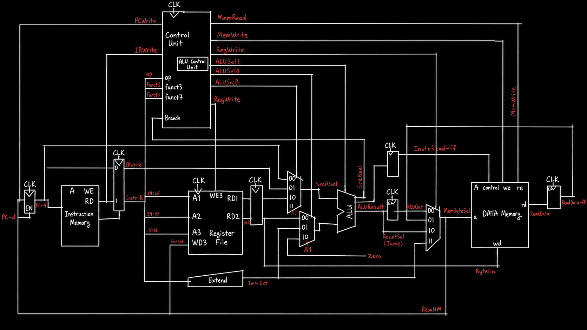
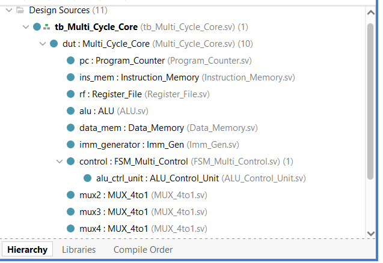
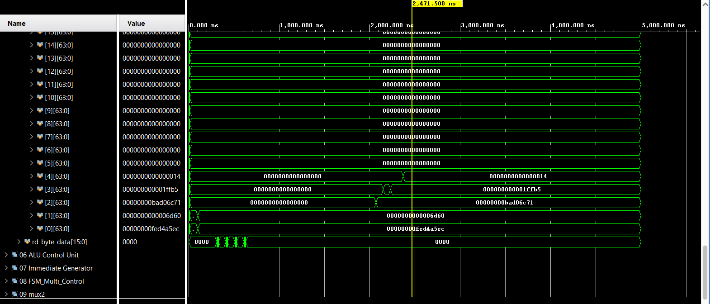
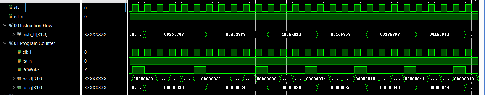
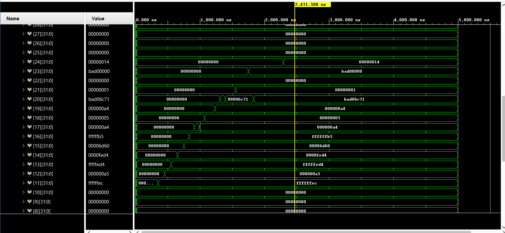
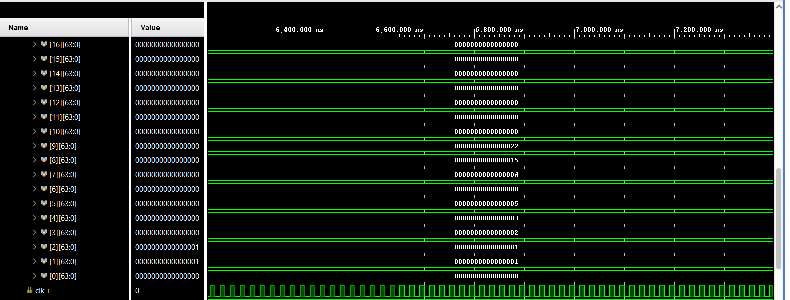
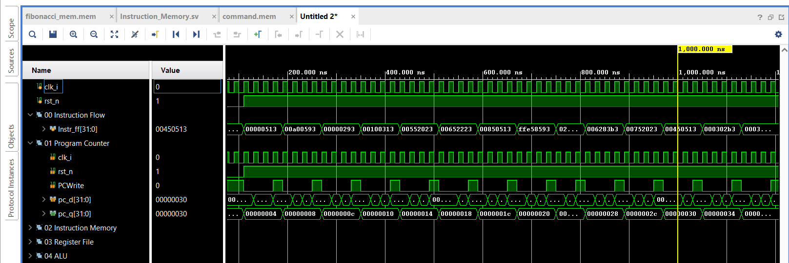
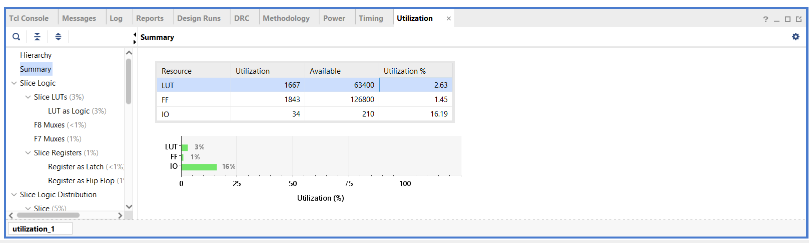

# Multi-Cycle RISC-V Core

A multi-cycle RISC-V (RV32I) processor core implemented in SystemVerilog and built around a finite-state-machine (FSM) control unit, simulated and synthesized in Xilinx Vivado. Unlike a single-cycle design, each instruction here executes over several clock cycles (Fetch → Decode → Execute → Memory → Write-back), which lets datapath resources like the ALU and memory be reused across cycles instead of duplicated.

---

## Table of Contents

- [Architecture](#architecture)
- [Supported Instructions](#supported-instructions)
- [Test Programs](#test-programs)
  - [Test 1 — Battery-Pack Safety Monitor](#test-1--battery-pack-safety-monitor)
  - [Test 2 — Fibonacci Sequence Generator](#test-2--fibonacci-sequence-generator)
- [Synthesis & Implementation Results](#synthesis--implementation-results)
- [Summary](#summary)
- [References](#references)

---

## Architecture

### Datapath Schematic

### Finite State Machine (Control Unit)

`S0 Fetch` and `S1 Decode` are common to every instruction; from there the FSM branches by instruction type:

Each state sets the relevant control signals (`ALUSrcA`, `ALUSrcB`, `IRWrite`, `PCWrite`, `PCUpdate`, `RegWrite`, `MemRead`, `MemWrite`, `ResultSrc`, `PCSrc`) for that cycle of execution.

### Module Hierarchy

Design source hierarchy as instantiated in Vivado, showing the core (`Multi_Cycle_Core`) and its submodules

---

## Supported Instructions

Based on the FSM's decode branches (`S1 Decode` → `Execute(R)` / `Execute(I)` / `MemAdr` / `JAL` / `JALR` / `BEQ`-`BNE` / `LUI`) and confirmed by the two test programs below, the core supports:

| Category | Instructions |
|:---|:---|
| R-type (register-register) | `ADD`, `SUB`, `AND`, `OR`, `XOR` |
| I-type (register-immediate) | `ADDI`, `ANDI`, `ORI`, `XORI`, `SLTI`, `SLTIU`, `SLLI`, `SRLI`, `SRAI` |
| Load | `LB`, `LBU`, `LH`, `LHU`, `LW` |
| Store | `SB`, `SH`, `SW` |
| Branch | `BEQ`, `BNE` |
| Jump | `JAL`, `JALR` |
| Upper immediate | `LUI`, `AUIPC` |

> This list reflects the instructions actually exercised in simulation (see [Test 1](#test-1--battery-pack-safety-monitor) and [Test 2](#test-2--fibonacci-sequence-generator)). If the design implements additional opcodes — e.g. `SLL`/`SLT`/`SLTU`/`SRL`/`SRA` register forms, or `BLT`/`BGE`/`BLTU`/`BGEU` — let me know and I'll extend this table.

---

## Test Programs

Two test programs were used to validate the core, each targeting a different kind of coverage.

### Test 1 — Battery-Pack Safety Monitor

  This is the primary instruction-coverage test — one coherent program written to exercise almost every instruction category the core supports (signed/unsigned loads and stores of every width, immediate and register ALU ops, shifts, logical ops, both branch directions, both jump forms, and both upper-immediate forms) instead of testing instructions one at a time. It's framed as reading a sensor packet and deciding whether a battery pack is in a safe or alarm state, so the arithmetic isn't arbitrary — each instruction does a real part of that decision.

**What it does:** it loads a 4-field packet from data memory — signed temperature, unsigned status byte, signed current (read both as signed and unsigned to exercise both sign-extension paths), and voltage — scales the current, derives a "status signature" from the status bits, and combines everything into a diagnostic word. It then checks two alarm conditions (temperature below `-10 °C`, or status byte `≥ 128`) and branches to a normal-result path or an alarm path that tags the diagnostic with an `0xBAD0_0000` signature and sets an alarm flag. `AUIPC` records the running program address at the end, and `JAL`/`JALR` implement the call/return to the packet-processing routine.

**Trace:** with temperature `-20 °C` (below threshold) *and* status `0xA5 = 165` (≥ 128), both alarm conditions are true, so execution falls through to the alarm path.

**Expected Data Memory Result**

| Address | Value | Meaning |
|:---|:---|:---|
| `data_mem[0]` | `FED4A5EC` | Original sensor packet |
| `data_mem[1]` | `00006D60` | Voltage: 28000 |
| `data_mem[2]` | `BAD06C71` | Alarm diagnostic result |
| `data_mem[3]` | `0001FFB5` | Alarm flag + scaled current |
| `data_mem[4]` | `00000014` | Address of the `AUIPC` instruction |

**Waveforms**

Program counter and instruction flow at reset — the PC holds at `0x00000000` while `rst_n` is low, then begins fetching the program:

Program counter and instruction flow mid-program, fetching the packet-processing load/shift/logic instructions:

Register file contents after execution — `x20 = BAD06C71` is the final alarm diagnostic, matching the trace above:

### Test 2 — Fibonacci Sequence Generator

A smaller, easier-to-verify complement to Test 1 — it checks arithmetic, memory writes, immediates, register updates, and a backward branch (loop) working together, confirming the datapath handles loop control correctly.

**Expected Data Memory Result**

| Byte Address | Decimal Value |
|:---|---:|
| `0x40` | 0 |
| `0x44` | 1 |
| `0x48` | 1 |
| `0x4C` | 2 |
| `0x50` | 3 |
| `0x54` | 5 |
| `0x58` | 8 |
| `0x5C` | 13 |
| `0x60` | 21 |
| `0x64` | 34 |

**Waveforms**

The `fibonacci_mem.mem` instruction file loaded into instruction memory, with the PC counting through the program as each instruction is fetched over multiple clock cycles:

By the end of the run, registers `[0]`–`[9]` hold the first ten Fibonacci numbers (`0, 1, 1, 2, 3, 5, 8, 13, 21, 34`), confirming the loop and its branch/arithmetic/memory instructions all executed correctly:

---

## Synthesis & Implementation Results

The design was synthesized and implemented in Vivado. Key results:

### Resource Utilization

| Resource | Used | Available | Utilization |
|:---|---:|---:|---:|
| LUT | 1,667 | 63,400 | 2.63% |
| FF  | 1,843 | 126,800 | 1.45% |
| IO  | 34 | 210 | 16.19% |

### Timing Summary

| Metric | Value |
|:---|---:|
| Worst Negative Slack (WNS) | 1.963 ns |
| Worst Hold Slack (WHS) | 0.175 ns |
| Worst Pulse Width Slack (WPWS) | 4.500 ns |
| Total Negative Slack (TNS) | 0.000 ns |
| Setup Endpoints | 3,187 (0 failing) |
| Hold Endpoints | 3,187 (0 failing) |
| Pulse Width Endpoints | 1,756 (0 failing) |

> ✅ All user-specified timing constraints are met, with no failing endpoints on setup, hold, or pulse-width checks.

---

## Summary

This core implements a working multi-cycle RISC-V datapath driven by an FSM control unit, verified functionally in simulation with two complementary test programs — a battery-pack safety-monitor routine exercising nearly the full supported instruction set (signed/unsigned loads and stores, immediate and register ALU ops, shifts, both branch directions, both jump forms, and both upper-immediate forms), and a Fibonacci sequence generator exercising loop/branch behavior — and confirmed synthesizable with a modest resource footprint (**~2.6% LUT / ~1.5% FF utilization**) and **no timing violations**.

## References

The processor architecture and instruction encoding used in this project are based on the following references:

1. **The RISC-V Instruction Set Manual, Volume I: Unprivileged Architecture**
   Used as the primary reference for RISC-V instruction formats, opcodes, register definitions, immediate encoding, arithmetic operations, memory instructions, and branch behavior.

2. **David A. Patterson and John L. Hennessy — _Computer Organization and Design: The Hardware/Software Interface, RISC-V Edition_**
   Used as the architectural reference for the multi-cycle datapath, FSM control unit design, register file, ALU, immediate generation, and instruction sequencing.

> The RISC-V ISA specification defines the required behavior of each instruction, while the Patterson and Hennessy architecture provides the basis for sequencing those instructions through a multi-cycle hardware datapath under FSM control.
 