# Pipelined RISC-V Core

A five-stage pipelined RISC-V (RV32I) processor core implemented in SystemVerilog and simulated, synthesized, and implemented in Xilinx Vivado. Unlike a multi-cycle CPU that advances one instruction through several FSM-controlled cycles, the pipelined datapath overlaps instruction execution across **Fetch → Decode → Execute → Memory → Write-back**. Pipeline registers separate the stages, and forwarding plus a hazard-detection unit handle data and control hazards.

---

## Table of Contents
 
- [Architecture](#architecture)
- [Hazard Handling](#hazard-handling)
- [Instruction Coverage](#instruction-coverage)
- [Test Programs](#test-programs)
  - [Test 1 — Battery-Pack Safety Monitor](#test-1--battery-pack-safety-monitor)
  - [Test 2 — Fibonacci, Binary Search, and GCD](#test-2--fibonacci-binary-search-and-gcd)
- [Load-Use Hazard Verification](#load-use-hazard-verification)
- [Synthesis & Implementation Results](#synthesis--implementation-results)
- [Summary](#summary)
- [References](#references)

---

## Architecture

### Datapath Schematic

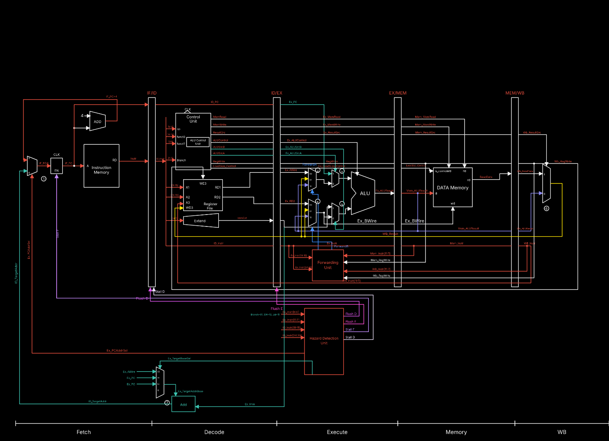

The core is organized into five stages:

| Stage | Main responsibility |
|:---|:---|
| **IF — Fetch** | Select the next PC and fetch an instruction from instruction memory. |
| **ID — Decode** | Decode the instruction, generate control signals, read the register file, and extend the immediate. |
| **EX — Execute** | Perform ALU operations, select forwarded operands, and calculate control-flow targets. |
| **MEM — Memory** | Read from or write to data memory for load/store instructions. |
| **WB — Write-back** | Select the result and write it into the destination register. |

The **IF/ID**, **ID/EX**, **EX/MEM**, and **MEM/WB** pipeline registers carry data and control information between stages. The datapath includes a register file, ALU and ALU control, immediate extension, instruction and data memories, forwarding unit, and hazard-detection unit.

### Hazard-Control Summary

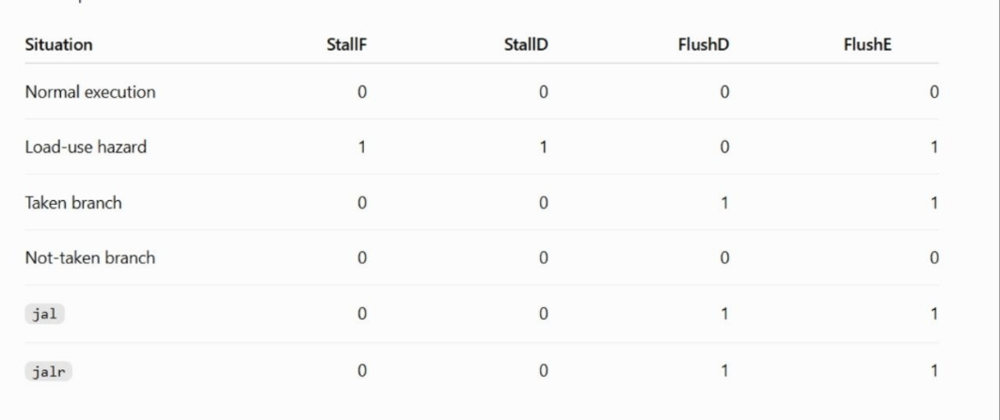

The table above documents the specified stall/flush behavior for normal execution, load-use dependencies, taken and not-taken branches, `JAL`, and `JALR`.

---

## Hazard Handling

### Data Hazards: Forwarding

The forwarding unit selects more recent results from later pipeline stages when a dependent instruction needs an operand before the register file has been updated. This avoids unnecessary stalls for dependencies that can be satisfied through forwarding.

### Load-Use Hazard: One-Cycle Stall

An immediately dependent instruction cannot consume load data before the memory access produces it. The hazard-detection unit therefore stalls Fetch and Decode and inserts a bubble into Execute for **one cycle**. This condition is demonstrated by the simulation waveform in [Load-Use Hazard Verification](#load-use-hazard-verification).

### Control Hazards: Flushes

The supplied control table and notes specify the following penalties:

| Situation | Penalty in cycles | Control action |
|:---|---:|:---|
| Load-use dependency | **1** | `StallF = 1`, `StallD = 1`, `FlushE = 1` |
| Taken branch | **2** | `FlushD = 1`, `FlushE = 1` |
| Not-taken branch | **0** | No flush or stall |
| `JAL` | **2** | `FlushD = 1`, `FlushE = 1` |
| `JALR` | **2** | `FlushD = 1`, `FlushE = 1` |

These values describe **the pipeline behavior in this design**, not universal penalties for every RISC-V processor.

---

## Instruction Coverage

The tests and the RV32I reference material supplied with this project cover the following instruction groups. The list below distinguishes **instructions clearly used in the described tests** from other possible ISA instructions; it is not a claim that every instruction shown in the reference chart has been individually verified.

| Category | Instructions explicitly described in tests |
|:---|:---|
| Arithmetic and comparison | `ADD`, `ADDI`, `SUB` and arithmetic/comparison operations used by the programs |
| Loads / stores | Signed and unsigned packet loads, and byte/halfword/word data accesses in the safety monitor |
| Branch | `BEQ`, `BGE`, `BLT` |
| Jump | `JAL`, `JALR` |
| Upper immediate | `LUI`, `AUIPC` |
| Other integer ALU operations | Shifts, masking and logical operations exercised by the safety-monitor routine |

The base instruction format and encoding reference is the **RISC-V Instruction Set Manual, Volume I**.

---

## Test Programs

Two simulation programs exercise complementary aspects of the design: arithmetic and memory operations in a sensor-processing task, and subroutine calls, loops, branches, binary search, and the GCD algorithm in a second program.

### Test 1 — Battery-Pack Safety Monitor

This test processes a sensor packet and produces a diagnostic and an alarm flag. It checks signed and unsigned loads, arithmetic and logical operations, shifts, stores of different widths, and control flow while running through the pipelined datapath.

**Input packet:**

| Location | Input | Value |
|:---|:---|:---|
| Byte 0 | Signed temperature | `-20` |
| Byte 1 | Unsigned status | `0xA5` (165) |
| Halfword at byte 2 | Signed current | `-300` |
| Word at byte 4 | Voltage | `28000` |

**What it does:** it extracts the sensor readings, scales the current, computes a diagnostic value, and raises an alarm for the configured unsafe conditions. The input temperature and status both satisfy the alarm conditions, so the program generates an alarm-tagged diagnostic.

**Expected Data Memory Result**

| Address | Value (hex) | Meaning |
|:---|:---|:---|
| `data_mem[0]` | `FED4A5EC` | Original sensor packet |
| `data_mem[1]` | `00006D60` | Voltage: 28000 |
| `data_mem[2]` | `BAD06C71` | Alarm diagnostic result |
| `data_mem[3]` | `0001FFB5` | Alarm flag and scaled current |
| `data_mem[4]` | `00000014` | Address of the `AUIPC` instruction |

Selected expected register values include `x11 = FFFFFFEC` (temperature), `x12 = 000000A5` (status), `x13 = FFFFFED4` (signed current), `x16 = FFFFFFB5` (scaled current), `x20 = BAD06C71` (diagnostic), and `x21 = 00000001` (alarm flag).

**Waveforms**

Instruction and program-counter activity through the pipeline during the battery-pack test:

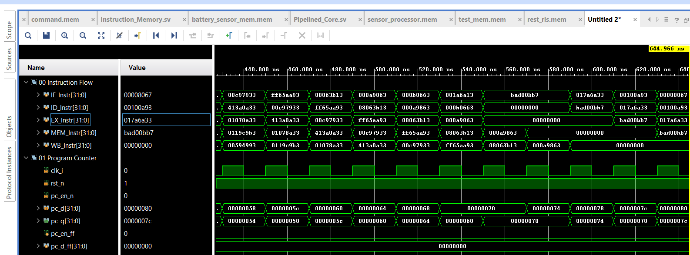

Selected register-file values at the end of simulation:

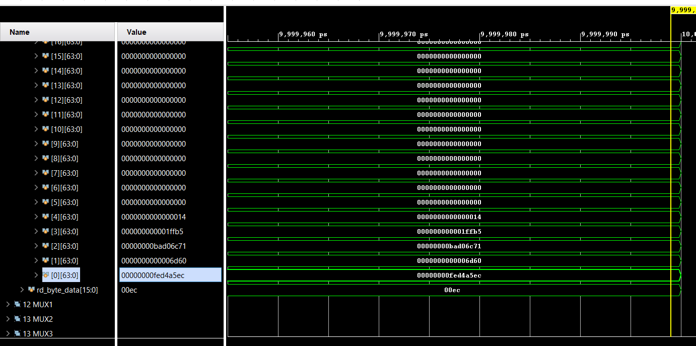

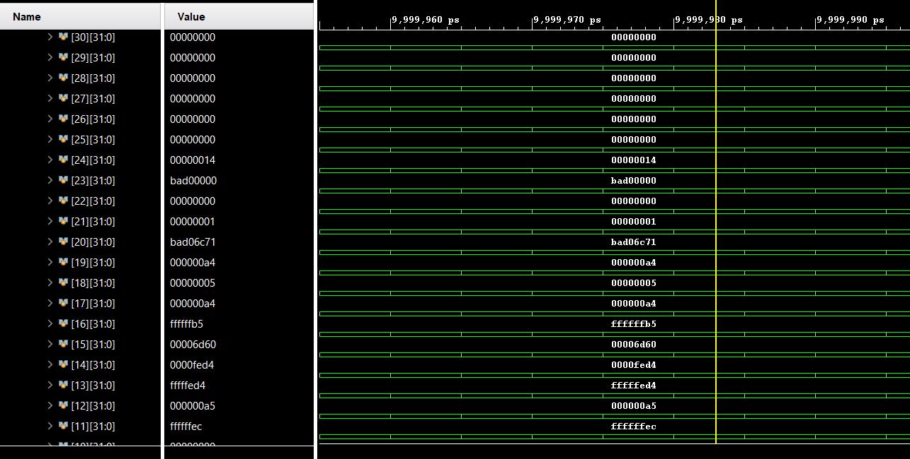

### Test 2 — Fibonacci, Binary Search, and GCD

This larger control-flow test combines multiple routines in a single program:

1. **Fibonacci:** generate the first twelve Fibonacci numbers in data memory (words 0–11).
2. **Binary search:** find `34` in the generated table and store its index.
3. **Self-check:** verify `fib[11] == fib[10] + fib[9]`.
4. **GCD:** calculate `gcd(55, 5)` using Euclid's subtraction-based algorithm. This does not require divide or remainder instructions, which are not part of base RV32I.

The test uses direct function calls (`jal ra, fib` and `jal ra, gcd`), an indirect call to `bsearch` through an `AUIPC`/`ADDI`/`JALR` sequence, `jalr zero, ra, 0` returns, unconditional `jal` loop jumps, and `BEQ`, `BGE`, and `BLT` branches.

**Program files described in the draft:** `imem.mem` has 64 words (62 program instructions plus padding), `dmem.mem` contains 64 initially zero words, and `program_listing.txt` maps addresses to machine code and assembly. The test assumes a PC reset address of zero and memory initialization via `$readmemh`.

**Expected Data Memory Result**

| Word index | Decimal value | Meaning |
|:---|:---|:---|
| `0–11` | `0, 1, 1, 2, 3, 5, 8, 13, 21, 34, 55, 89` | Fibonacci table |
| `16` | `9` | Index of 34 found by binary search |
| `17` | `5` | `gcd(55, 5)` |
| `18` | `1` | Fibonacci self-check passed |

**Waveforms**

Generated Fibonacci sequence stored in data memory:

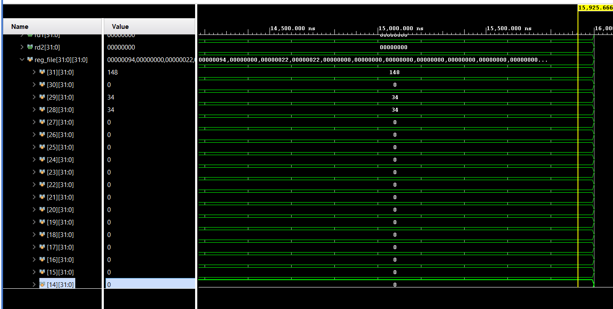

Additional output words and result signals for the combined test:

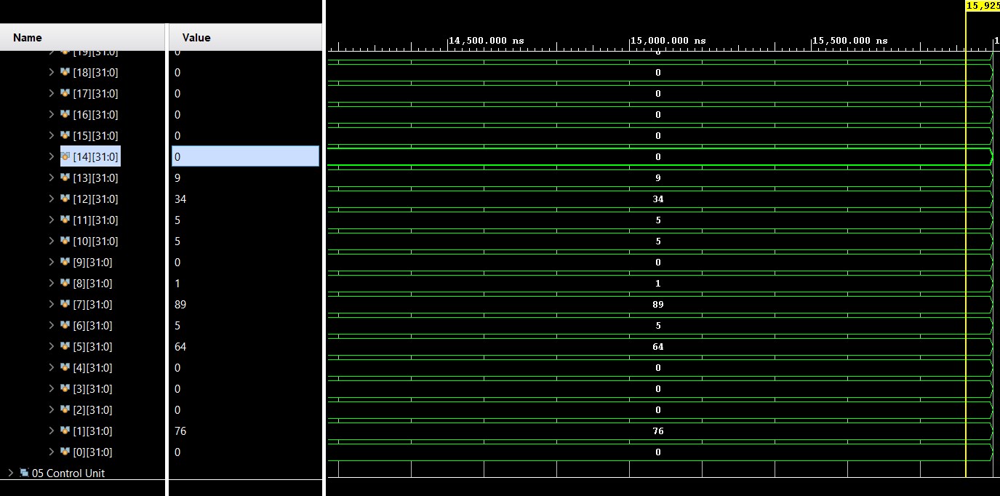

Register-file contents at the end of the test:

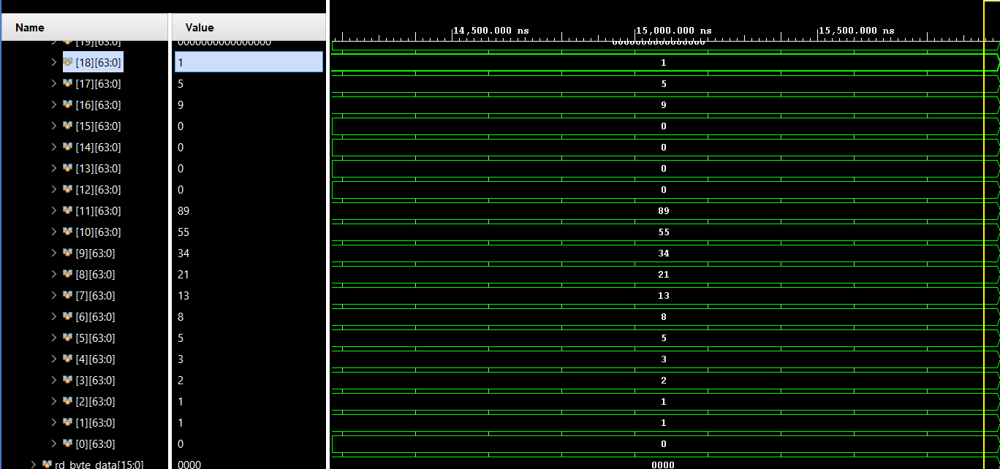

---

## Load-Use Hazard Verification

An additional simulation focuses on **one stall cycle for a load-use dependency**, independently of the larger software tests. The waveform records instruction activity alongside the pipeline stall/flush signals.

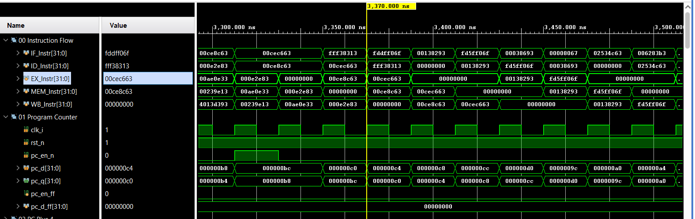

When an instruction immediately after a load uses the loaded destination register, the pipeline holds Fetch and Decode (`StallF`, `StallD`) and flushes the Execute-stage input (`FlushE`). The dependent operation then proceeds once its operand can be supplied.

---

## Synthesis & Implementation Results

The design was synthesized and implemented in Xilinx Vivado. The figures below are taken from the **pipelined core's** Vivado report screenshots.

### Resource Utilization

| Resource | Used | Available | Utilization |
|:---|---:|---:|---:|
| LUT | 934 | 63,400 | 1.47% |
| FF | 1,315 | 126,800 | 1.04% |
| IO | 34 | 210 | 16.19% |

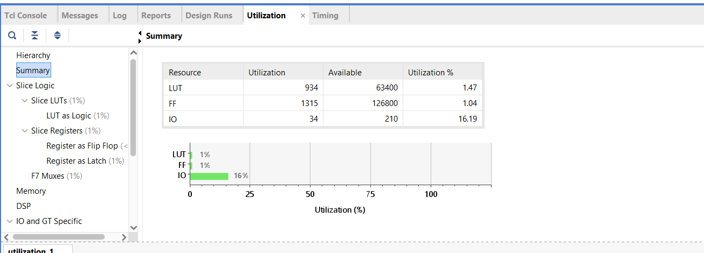

### Timing Summary

| Metric | Value |
|:---|---:|
| Worst Negative Slack (WNS) | **2.655 ns** |
| Worst Hold Slack (WHS) | **0.148 ns** |
| Worst Pulse Width Slack (WPWS) | **4.500 ns** |
| Total Negative Slack (TNS) | 0.000 ns |
| Total Hold Slack (THS) | 0.000 ns |
| Total Pulse Width Negative Slack (TPWS) | 0.000 ns |
| Setup Endpoints | 372 (0 failing) |
| Hold Endpoints | 372 (0 failing) |
| Pulse Width Endpoints | 323 (0 failing) |

> **All user-specified timing constraints are met**, with zero failing setup, hold, or pulse-width endpoints in the supplied report.

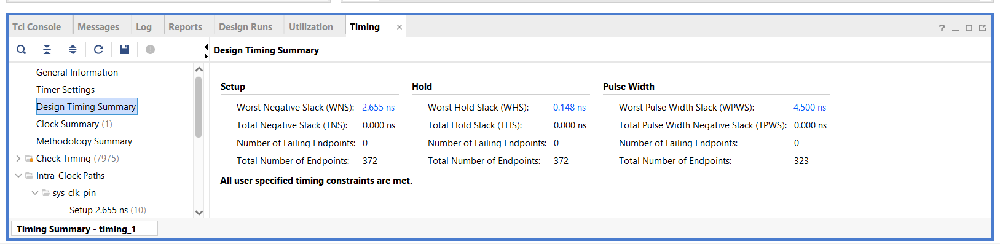

---

## Summary

This project implements a five-stage pipelined RISC-V datapath with forwarding, load-use hazard detection, and control-hazard flushing. Simulation material covers two practical software tests—a battery-pack safety monitor and a combined Fibonacci/binary-search/GCD program—plus a focused **one-cycle load-use stall** demonstration. Vivado reports show a small utilization footprint (**934 LUTs, 1,315 FFs**) and **no reported timing violations** under the supplied constraints.

## References

1. **The RISC-V Instruction Set Manual, Volume I: Unprivileged Architecture**  
   Reference for RV32I instruction formats, encodings, arithmetic, memory and branch behavior.  
   https://github.com/riscv/riscv-isa-manual

2. **David A. Patterson and John L. Hennessy — _Computer Organization and Design: The Hardware/Software Interface, RISC-V Edition_**  
   Architectural reference for the pipelined datapath, register file, ALU, control, forwarding, and hazards.

3. **Pipeline datapath / hazard-control tutorial referenced in the working draft**  
   https://youtu.be/UZdURUwQMmk?si=J899O0wA136Ah6Q6
