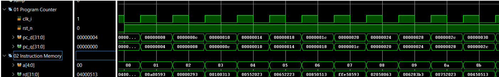
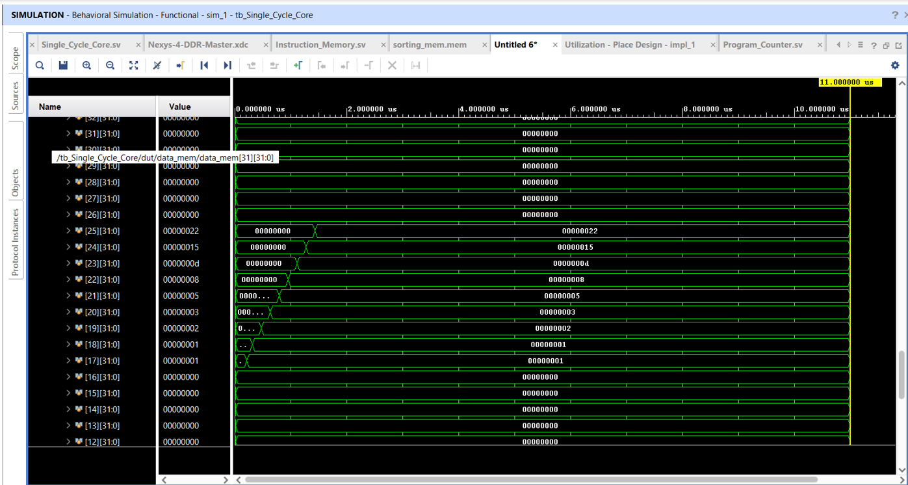
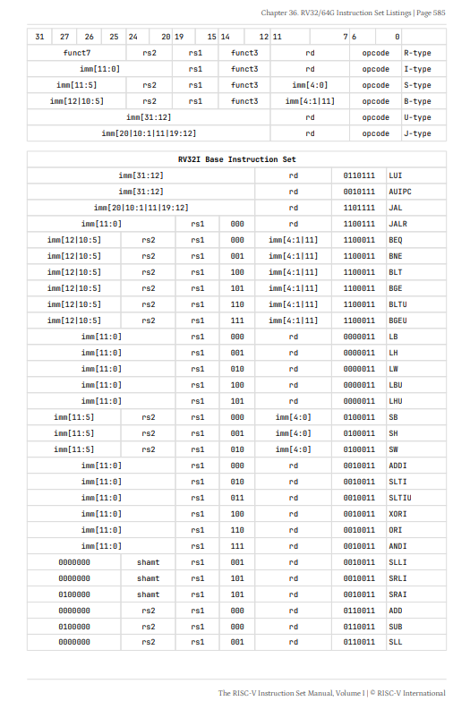
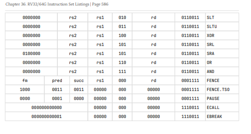

# Single-Cycle RISC-V Core

A single-cycle RISC-V processor core designed, simulated, and synthesized in Xilinx Vivado. This report walks through the datapath architecture, functional (behavioral) simulation waveforms, and the post-synthesis utilization and timing results.

## Table of Contents
 
- [Architecture](#architecture)
- [Functional Simulation](#functional-simulation)
- [Synthesis & Implementation Results](#synthesis--implementation-results)
- [Fibonacci Test Program](#fibonacci-test-program)
- [Vivado Waveform TCL Script](#vivado-waveform-tcl-script)
- [RV32I Base Instruction Set Reference](#rv32i-base-instruction-set-reference)
- [Summary](#summary)
- [References](#references)

## Architecture

The datapath below shows the core's single-cycle organization: PC update logic, instruction memory, register file, ALU, and the control signals that route data between them each clock cycle.


Supporting block-level view of the core's control/data flow:


## Functional Simulation

The waveforms below were captured from a behavioral simulation testbench (`tb_Single_Cycle_Core`) driving the core through a sequence of instructions.

**Program Counter & Instruction Fetch** — the PC advances by 4 each cycle (`0x00000004` → `0x00000008` → `0x0000000c` → …), correctly indexing into instruction memory and fetching the expected 32-bit instruction words.



**Register File Contents** — register values captured across the simulation, showing writes propagating correctly as instructions execute.


**Full Behavioral Simulation** — end-to-end simulation run showing register updates over time as the test program executes.



## Synthesis & Implementation Results

The design was synthesized and implemented in Vivado. Key results:

**Resource Utilization**

| Resource | Used | Available | Utilization |
|---|---|---|---|
| LUT | 883 | 63,400 | 1.39% |
| FF | 239 | 126,800 | 0.19% |
| IO | 34 | 210 | 16.19% |


**Timing Summary**

| Metric | Value |
|---|---|
| Worst Negative Slack (WNS) | 4.363 ns |
| Worst Hold Slack (WHS) | 0.287 ns |
| Worst Pulse Width Slack (WPWS) | 4.500 ns |
| Total Negative Slack (TNS) | 0.000 ns |
| Failing Endpoints (Setup/Hold/Pulse Width) | 0 / 0 / 0 |

All user-specified timing constraints are met, with no failing endpoints on setup, hold, or pulse-width checks.


 
## Fibonacci Test Program
 
A Fibonacci program is included as an instruction-memory test (`Fibonacci_mem.mem`). It exercises multiple parts of the single-cycle RISC-V datapath together, including arithmetic, memory access, immediate operations, register updates, and branch instructions.
 
The program generates the first ten Fibonacci numbers and stores them in data memory beginning at byte address `0x40` (decimal 64).
 
### Instruction Memory Contents
 
```text
04000513
00A00593
00000293
00100313
00552023
00652223
00850513
FFE58593
02058063
006283B3
00752023
00450513
000302B3
00038333
FFF58593
FE0002E3
00000063
```
 
### Equivalent Assembly
 
```asm
# Initial configuration
addi x10, x0, 64      # Current output address
addi x11, x0, 10      # Number of Fibonacci elements
addi x5,  x0, 0       # Previous = 0
addi x6,  x0, 1       # Current  = 1
 
# Store first two values
sw   x5, 0(x10)       # Memory[64] = 0
sw   x6, 4(x10)       # Memory[68] = 1
 
# Prepare remaining elements
addi x10, x10, 8      # Next output address
addi x11, x11, -2     # Eight values remain
 
fib_loop:
beq  x11, x0, fib_done
 
add  x7, x5, x6       # next = previous + current
sw   x7, 0(x10)       # Store result
 
addi x10, x10, 4      # Move to next memory address
add  x5, x6, x0       # previous = current
add  x6, x7, x0       # current = next
 
addi x11, x11, -1     # Decrement remaining count
beq  x0, x0, fib_loop # Unconditional branch
 
fib_done:
beq  x0, x0, fib_done # Infinite loop
```
 
### Expected Data Memory Result
 
| Byte Address | Decimal Value |
|:---|---:|
| `0x40` | 0 |
| `0x44` | 1 |
| `0x48` | 1 |
| `0x4C` | 2 |
| `0x50` | 3 |
| `0x54` | 5 |
| `0x58` | 8 |
| `0x5C` | 13 |
| `0x60` | 21 |
| `0x64` | 34 |
 
This test is useful because it verifies several datapath paths together instead of testing only one instruction at a time.
 
The following parts of the processor are exercised:
 
- **ALU** — `ADD` and `ADDI`
- **Register File** — source-register reads and destination-register writes
- **Data Memory** — `SW`
- **Immediate Generator** — immediate values used by arithmetic and branch instructions
- **Branch Logic** — `BEQ`
- **Program Counter Logic** — sequential execution and branch redirection
---
 
## Vivado Waveform TCL Script
 
A TCL helper script is used to organize the Vivado behavioral-simulation waveform window according to the main processor modules.
 
Instead of manually adding and sorting individual signals, the script automatically creates waveform groups for the program counter, instruction memory, register file, ALU, data memory, control units, immediate generator, and multiplexers.
 
### TCL Script
 
```tcl
set CPU_ROOT /tb_Single_Cycle_Core/dut
 
proc add_module_group {group_name scope_path} {
    set module_scope [get_scopes -quiet $scope_path]
 
    if {[llength $module_scope] == 0} {
        puts "WARNING: Scope not found: $scope_path"
        return
    }
 
    set group_object [add_wave_group $group_name]
 
    add_wave \
        -into $group_object \
        -recursive \
        $module_scope
 
    puts "Added: $scope_path"
}
 
add_module_group "01 Program Counter" $CPU_ROOT/pc
add_module_group "02 Instruction Memory" $CPU_ROOT/ins_mem
add_module_group "03 Register File" $CPU_ROOT/rf
add_module_group "04 ALU" $CPU_ROOT/alu
add_module_group "05 Data Memory" $CPU_ROOT/data_mem
add_module_group "06 ALU Control Unit" $CPU_ROOT/alu_ctrl_unit
add_module_group "07 Immediate Generator" $CPU_ROOT/imm_generator
add_module_group "08 Control Unit" $CPU_ROOT/control
add_module_group "09 Data MUX" $CPU_ROOT/mux_data
add_module_group "10 ALU MUX" $CPU_ROOT/mux_alu
add_module_group "11 PC MUX" $CPU_ROOT/mux_pc
add_module_group "12 PC Plus 4" $CPU_ROOT/pc_plus_4
add_module_group "13 PC Plus Immediate" $CPU_ROOT/pc_plus_imm
add_module_group "14 Register Control MUX" $CPU_ROOT/rf_control
add_module_group "15 PC Control MUX" $CPU_ROOT/pc_control
```
 
### Waveform Groups
 
| # | Module |
|---:|:---|
| 01 | Program Counter |
| 02 | Instruction Memory |
| 03 | Register File |
| 04 | ALU |
| 05 | Data Memory |
| 06 | ALU Control Unit |
| 07 | Immediate Generator |
| 08 | Control Unit |
| 09 | Data MUX |
| 10 | ALU MUX |
| 11 | PC MUX |
| 12 | PC Plus 4 |
| 13 | PC Plus Immediate |
| 14 | Register Control MUX |
| 15 | PC Control MUX |
 
This makes debugging easier because signals belonging to the same hardware block remain grouped together in the simulation window.
 
---
 
## RV32I Base Instruction Set Reference
 
Instruction encoding tables from *The RISC-V Instruction Set Manual, Volume I*, used as the ground truth for opcode, `funct3`/`funct7`, and immediate-field encoding while implementing the datapath and control logic.
 
**Instruction Formats & Base Instruction Set (p. 585)**
 

 
**Base Instruction Set, continued (p. 586)**
 

 
---
---
 
## Summary
 
The core implements a working single-cycle RISC-V datapath, verified functionally in simulation (correct PC increment, instruction fetch, and register writes) and confirmed synthesizable with a small resource footprint (**<2% LUT/FF utilization**) and **no timing violations**.
 
---
 
## References
 
The processor architecture and instruction encoding used in this project are based on the following references:
 
1. **The RISC-V Instruction Set Manual, Volume I: Unprivileged Architecture**
   Used as the primary reference for RISC-V instruction formats, opcodes, register definitions, immediate encoding, arithmetic operations, memory instructions, and branch behavior.
2. **David A. Patterson and John L. Hennessy — _Computer Organization and Design: The Hardware/Software Interface, RISC-V Edition_**
   Used as the architectural reference for the single-cycle datapath, register file, ALU, control logic, immediate generation, branch path, and processor organization.
> The RISC-V ISA specification defines the required behavior of each instruction, while the Patterson and Hennessy architecture provides the basis for implementing those instructions in a single-cycle hardware datapath.
 
 