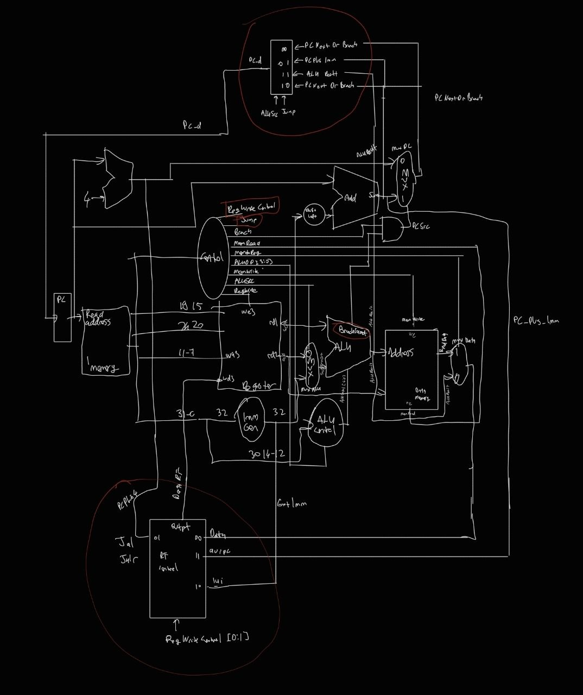
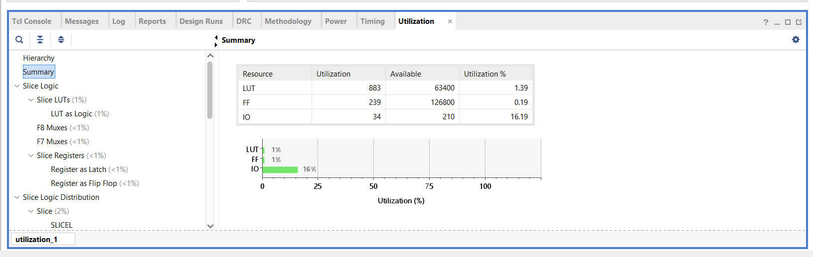
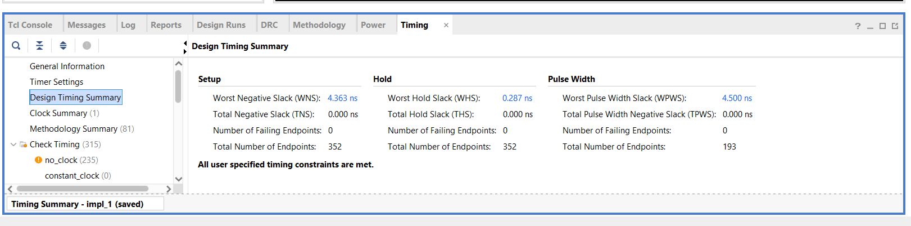

# Single-Cycle RISC-V Core

A single-cycle RISC-V processor core designed, simulated, and synthesized in Xilinx Vivado. This report walks through the datapath architecture, functional (behavioral) simulation waveforms, and the post-synthesis utilization and timing results.

## Table of Contents

- [Architecture](#architecture)
- [Functional Simulation](#functional-simulation)
- [Synthesis & Implementation Results](#synthesis--implementation-results)
- [Summary](#summary)

## Architecture

The datapath below shows the core's single-cycle organization: PC update logic, instruction memory, register file, ALU, and the control signals that route data between them each clock cycle.

Supporting block-level view of the core's control/data flow:

## Functional Simulation

The waveforms below were captured from a behavioral simulation testbench (`tb_Single_Cycle_Core`) driving the core through a sequence of instructions.

**Program Counter & Instruction Fetch** — the PC advances by 4 each cycle (`0x00000004` → `0x00000008` → `0x0000000c` → …), correctly indexing into instruction memory and fetching the expected 32-bit instruction words.

**Register File Contents** — register values captured across the simulation, showing writes propagating correctly as instructions execute.

**Full Behavioral Simulation** — end-to-end simulation run showing register updates over time as the test program executes.

## Synthesis & Implementation Results

The design was synthesized and implemented in Vivado. Key results:

**Resource Utilization**

| Resource | Used | Available | Utilization |
|---|---|---|---|
| LUT | 883 | 63,400 | 1.39% |
| FF | 239 | 126,800 | 0.19% |
| IO | 34 | 210 | 16.19% |

**Timing Summary**

| Metric | Value |
|---|---|
| Worst Negative Slack (WNS) | 4.363 ns |
| Worst Hold Slack (WHS) | 0.287 ns |
| Worst Pulse Width Slack (WPWS) | 4.500 ns |
| Total Negative Slack (TNS) | 0.000 ns |
| Failing Endpoints (Setup/Hold/Pulse Width) | 0 / 0 / 0 |

All user-specified timing constraints are met, with no failing endpoints on setup, hold, or pulse-width checks.

## Summary

The core implements a working single-cycle RISC-V datapath, verified functionally in simulation (correct PC increment, instruction fetch, and register writes) and confirmed synthesizable with a small resource footprint (<2% LUT/FF utilization) and no timing violations.
